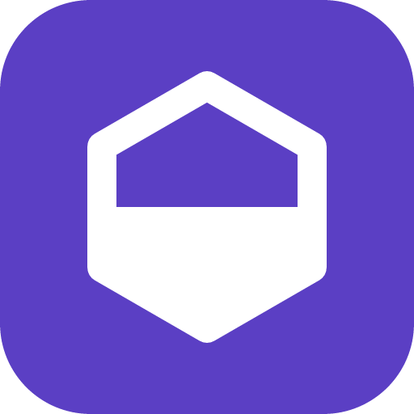
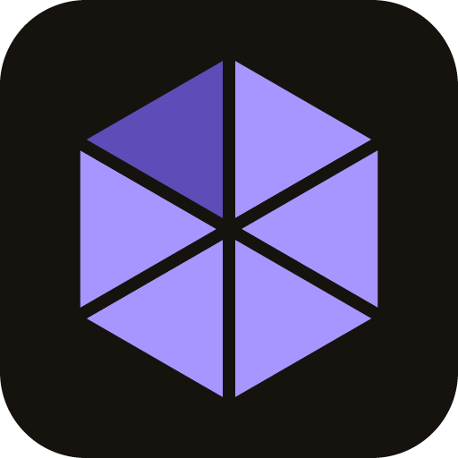

# HexaScore app icon candidates

Three hand-written SVG candidates (owner round 2026-11-01, item 4). **Selected: candidate 3** (owner, 2026-11-01), for the web and the Android app. Colours come from the design tokens: primary `#5b3fc4`, dark-mode primary `#a796ff`, dark ledge `#5e4db8`, ink `#16130f` (token `fg`, light). No fonts, no third-party marks.

| Candidate | 512 px | 32 px | 16 px | Idea |
| --- | --- | --- | --- | --- |
| 1 |  |  |  | Purple hexagon with a white slab-serif "H": the editorial heading face reduced to a mark |
| 2 |  |  |  | Purple tile with a white hexagon half filled, a score gauge |
| 3 (selected) |  |  |  | Ink tile with a hexagon of six wedges, five lit: six rating categories |

Files per candidate `N`: `hexascore-icon-N.svg` plus PNG exports at 16, 32, 180, 192 and 512 px (`hexascore-icon-N-<size>.png`).

## Switching the icon

The navbar (`APP_ICON` in `resources/js/components/Nav.tsx`) and the HTML head (`resources/views/app.html`: SVG favicon and `apple-touch-icon`) read only `app-icon.svg` and `app-icon-180.png`, which are copies of the chosen candidate (now 3). `/favicon.ico` holds the 16 and 32 px PNGs of the same candidate. To switch to candidate `N`:

```sh
cd resources/public/icons
cp "hexascore-icon-$N.svg" app-icon.svg
cp "hexascore-icon-$N-180.png" app-icon-180.png
# favicon.ico: an ICO header wrapping the 16 and 32 px PNGs (Python standard library only)
python - "$N" <<'PY'
import struct, sys
n = sys.argv[1]
pngs = [(s, open(f"hexascore-icon-{n}-{s}.png", "rb").read()) for s in (16, 32)]
out, off = struct.pack("<HHH", 0, 1, len(pngs)), 6 + 16 * len(pngs)
data = b""
for s, png in pngs:
    out += struct.pack("<BBBBHHII", s, s, 0, 0, 1, 32, len(png), off + len(data))
    data += png
open("../favicon.ico", "wb").write(out + data)
PY
```

## Regenerating the PNGs

The exports were made with the `resvg` CLI 0.48.1 (not a project dependency):

```sh
for n in 1 2 3; do for s in 16 32 180 192 512; do
  resvg -w "$s" -h "$s" "hexascore-icon-$n.svg" "hexascore-icon-$n-$s.png"
done; done
```

## Android app and Play listing

`apps/mobile/assets/images/icon.png` (1024 px, square tile), `adaptive-icon.png` (1024 px, the hexagon alone on transparent, about 62 % of the canvas, inside the 66 % safe zone; background `#16130f` in `app.config.ts`) and `apps/mobile/store/listing/icon-512.png` (512 px, square tile) come from candidate 3:

```sh
I=resources/public/icons/hexascore-icon-3.svg
sed 's/ rx="96"//' "$I" > /tmp/square.svg
sed -e '/<rect /d' -e 's#<g stroke#<g transform="translate(256 256) scale(0.78) translate(-256 -256)" stroke#' "$I" > /tmp/fg.svg
resvg -w 1024 -h 1024 /tmp/square.svg apps/mobile/assets/images/icon.png
resvg -w 1024 -h 1024 /tmp/fg.svg apps/mobile/assets/images/adaptive-icon.png
resvg -w 512 -h 512 /tmp/square.svg apps/mobile/store/listing/icon-512.png
```
